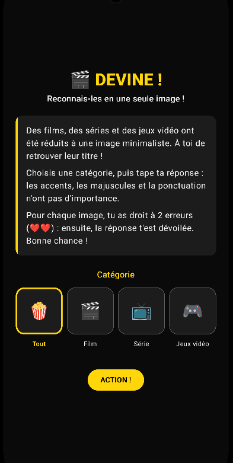
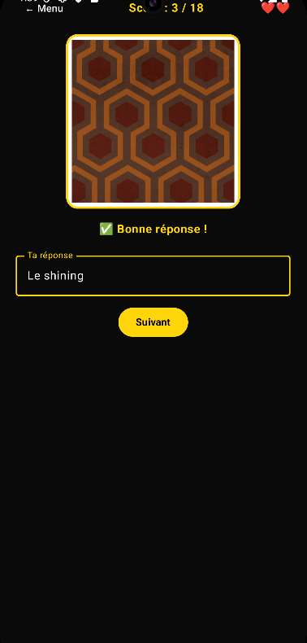
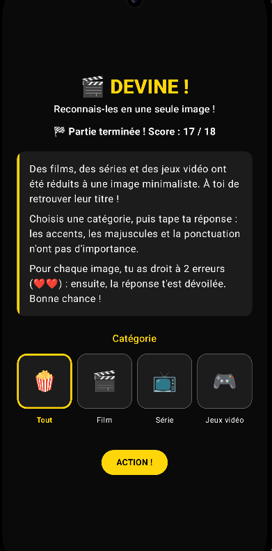

# 🎬 Devine !

> Reconnais des films, des séries et des jeux vidéo à partir d'une seule image minimaliste.

Application Android **native**, écrite en **Kotlin** avec **Jetpack Compose**.

<p align="center">
  
  
  
</p>

## Le principe

Des films, des séries et des jeux vidéo sont réduits à une image minimaliste. Le joueur choisit une catégorie, puis tape le titre de ce qu'il reconnaît. Pour chaque image, il a droit à **2 erreurs** (❤️❤️) : ensuite, la réponse est dévoilée et on passe à la suivante.

## Fonctionnalités

- 3 catégories (Film, Série, Jeux vidéo) et un mode « Tout » qui les mélange
- Réponse en texte libre, tolérante : accents, majuscules, ponctuation et espaces sont ignorés (« x men » est accepté pour « X-Men »)
- 2 erreurs par image, avec les essais restants affichés en cœurs
- Score, fin de partie et retour au menu
- Thème jaune et noir inspiré du cinéma, icône personnalisée
- Contenu entièrement configurable : on ajoute des images et une ligne dans un fichier JSON, sans toucher au code

## Stack technique

- **Kotlin**
- **Jetpack Compose** et **Material 3** pour l'interface
- Architecture **MVVM** : un `ViewModel` expose un état unique (`GameUiState`) via `StateFlow`, l'interface se contente de l'afficher
- **Coroutines** : chargement des données et des images hors du thread principal
- Données locales : `assets/data.json` lu avec `org.json`, images dans `assets/images/`. Aucune connexion nécessaire, l'appli fonctionne hors ligne

## Structure du projet

```
app/src/main/
├── assets/
│   ├── data.json              # la liste des images et leurs réponses
│   └── images/                # les images à deviner
└── java/com/example/deviname/
    ├── model/GameModels.kt        # Category, GameItem
    ├── data/GameRepository.kt     # lecture du JSON et des images
    ├── viewmodel/GameViewModel.kt # règles du jeu et état de la partie
    └── ui/MainActivity.kt         # écrans Compose (accueil, jeu)
```

## Installer et lancer

**Installer l'APK (Android)**
1. Ouvre la page [Releases](https://github.com/viko73/DeviNames/releases) et télécharge `devine.apk`.
2. Ouvre le fichier et autorise l'installation depuis cette source si Android le demande.

**Depuis Android Studio**
1. Clone le dépôt : `git clone https://github.com/viko73/DeviNames.git`
2. Ouvre le dossier dans Android Studio et laisse Gradle se synchroniser.
3. Lance l'appli sur un émulateur ou sur un téléphone en mode développeur.

## Ajouter ses propres images

1. Place l'image dans `app/src/main/assets/images/`.
2. Ajoute une ligne dans `app/src/main/assets/data.json` :

```json
{ "file": "inception.png", "title": "Inception", "category": "film" }
```

Les catégories possibles sont `film`, `serie` et `jeux_video`.

## Démo web

Une version web du jeu, jouable sans rien installer, est disponible ici : **[https://viko73.github.io/DeviName/](https://viko73.github.io/DeviName/)**

Elle reprend les mêmes règles, mais c'est un site en HTML, CSS et JavaScript : l'application native est celle de ce dépôt.

## Pistes d'amélioration

- Indices progressifs (l'image se révèle petit à petit)
- Chronomètre par image
- Sauvegarde du meilleur score
- Tests unitaires sur le `ViewModel`

## Développement

Projet réalisé pour découvrir Android Studio et Jetpack Compose, avec l'aide d'un assistant IA (Claude) pour la prise en main.
